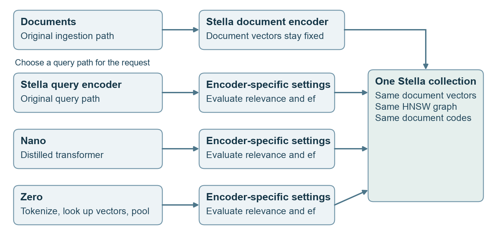
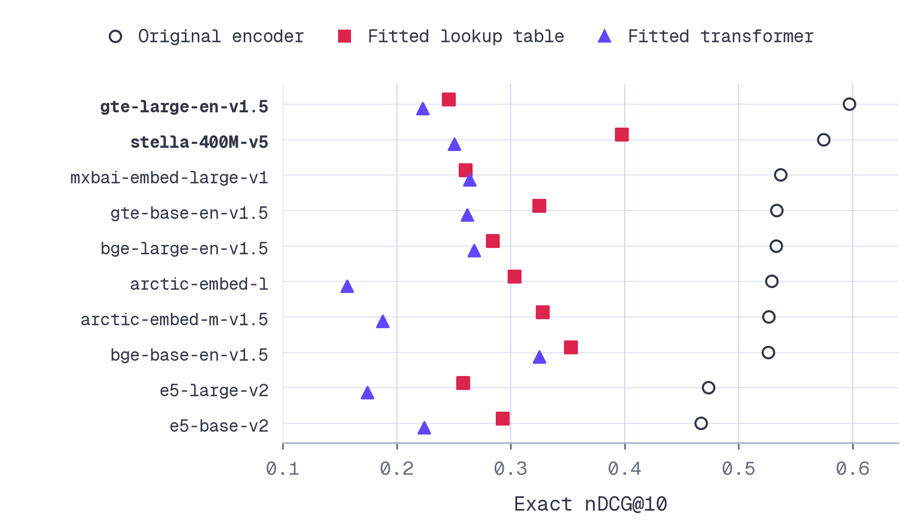
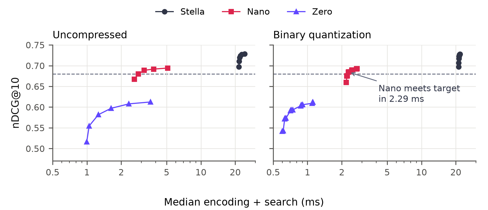
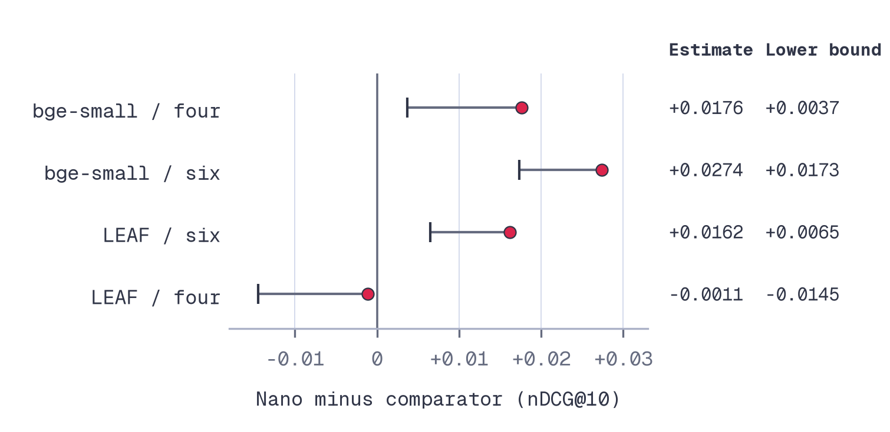
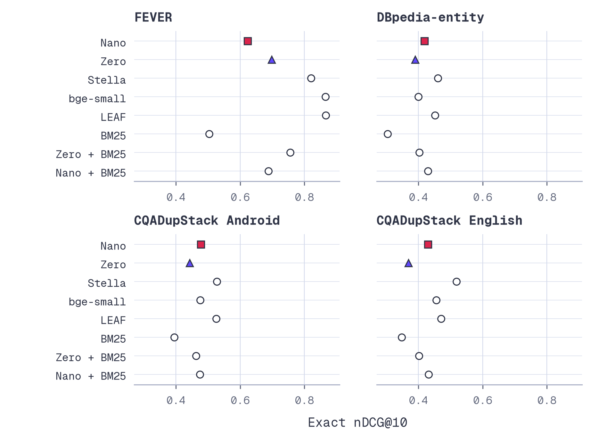

# Constella: Reducing the Cost of Dense Retrieval on a Frozen Index

## Abstract

Replacing an embedding model can require re-encoding the entire corpus. We trained two query encoders for an existing index built with Stella, a 400-million-parameter English embedding model. Constella Nano uses a smaller transformer. Constella Zero produces dense query vectors from a learned lookup table without running a neural network. An application can choose among all three encoders for each request while keeping the same index.

On a binary-quantized index of one million MS MARCO passages, Stella took a median of 21.3 ms for query encoding and search. Zero took 1.1 ms, a 19× speedup, and retained 85% of Stella's relevance score. Nano took 2.5 ms, an 8.6× speedup, and retained 95%.

In a matched test on the same workload, Zero scored 24.5% higher than BM25 on relevance and took 0.45 ms longer at the median. That makes a lookup table a practical option for traffic where it meets the application's relevance target. We show how to test that choice on an existing index, using judged queries to determine where a cheaper encoder is good enough and timing the full request to see what it saves.

## 1. Introduction

Changing the embedding model behind an existing search index can mean re-encoding the entire corpus. The query encoder runs on every uncached request, so replacing that part alone could reduce a recurring cost. We asked how much of that work a cheaper encoder could take over while the documents and index stayed fixed.

The original query encoder served as the teacher. We ran it on example queries and used its output vectors to train a cheaper student encoder. Because the student learned to produce vectors in the same space, it could search the documents already in the index. Prior work established this form of distillation [3, 5]. We asked whether one index could support several query encoders with different costs, and how much retrieval quality each could preserve.

We first tested whether the replacement could still rank relevant documents well. For each query in a separate evaluation set, we ranked every document by cosine similarity. We compared those rankings against relevance judgments (§2). We then measured encoding and search together. A replacement can need a wider search over the same graph, which can consume some of the time saved during encoding (§5).

We chose ten public English embedding models with the same tokenizer vocabulary and used the same method to fit a lookup table for each. On six retrieval benchmarks, the model with the highest score using its original query encoder produced the lowest-scoring lookup table. We chose Stella for the case study because its fitted lookup table scored highest in that comparison.

We trained two query encoders for Stella. Nano is a distilled transformer, and Zero builds query vectors from a learned lookup table without running a neural network. Both Constella encoders can search the same index as Stella (Figure 1).

**Figure 1.** Stella encodes documents at ingestion. Stella's original query encoder, Nano's distilled transformer, and Zero's lookup table all search the same index. Zero tokenizes each query and pools the vectors it looks up. Each encoder can use its own search breadth. This setting controls how widely Qdrant explores the graph (ef in the diagram, hnsw_ef in Qdrant).

### Prior work and scope

Prior studies established that a distilled query encoder can search document vectors produced by its teacher [3–5]. Static token representations also reduce query encoding cost [6]. pyNIFE uses this approach to fit a lookup encoder for an existing teacher index [7]. We applied the same fitting procedure across teachers to test whether stronger original retrievers yield stronger replacements. We then measured how much of the encoding speedup remained once search was included.

Prior studies of graph search have examined how differences between query and document distributions affect approximate retrieval [11, 12]. Our evaluation covered related English embedding models, with fully trained replacements evaluated on Stella's index. The exploratory graph study covered three workloads in Qdrant with a single graph configuration.

## 2. Which teachers yield the strongest replacements?

For an existing index, the original embedding model is already the teacher. We compared teachers to see whether their retrieval scores could predict how well their replacements would rank documents.

For each of the ten models in Figure 2, we fitted a lookup table and a projection on top of a frozen transformer. We used ridge regression, which fits the teacher's query vectors while applying a penalty to constrain the fitted weights. Both candidates searched the original model's existing document vectors. The registered comparison covered lookup tables for those ten models. We also evaluated the transformer fits in an exploratory analysis [1].

We fitted the candidates to the original encoders' vectors for 337,981 queries. To choose the penalty strength, we compared how well each setting ranked documents on separate judged queries from the CQADupStack Physics and Programmers forums. We then fixed that setting and evaluated the candidates on six other datasets using exact cosine search. We gave each dataset equal weight. Our metric, nDCG@10, rewards placing relevant documents higher in the top ten results [13].

Among the ten registered models, gte-large-en-v1.5 ranked first with its original encoder and last with its fitted lookup table. Stella produced the highest-scoring table. Both models used 1,024-dimensional vectors. The cause of the reversal remains open. We tested 16 more models to see whether the pattern held beyond the original ten. Across all 26, a model's original retrieval rank gave little indication of where its lookup table would rank [1].

**Figure 2.** Exact nDCG@10 averaged across six datasets. The ten registered models are ordered by the retrieval score of their original encoder [1].

We also tested whether query-vector similarity could predict retrieval quality. We measured similarity as the mean cosine similarity between each table's query vectors and its original encoder's vectors. Both e5 tables matched their original encoders more closely than Stella's table did, but both scored lower on retrieval [1].

The table that ranked first on the development queries also ranked first on the evaluation datasets. A predictor based on the original encoder's retrieval score and vector dimension picked a weaker table. In a follow-up with seven new models with completed table fits, the two methods picked tables with the same evaluation score [1].

For an existing index, use its original model as the teacher. Compare replacement encoders on separate queries with relevance judgments. In our registered comparison, fitting a table took four to seven minutes per model on an A100. That time included encoding the training queries, except for Stella, whose vectors were already cached [1].

### How we fitted the candidate encoders

**Training targets.** For each training query, we ran the original encoder locally with its usual preprocessing and prompt. We used its output vector as the target for both candidates. The candidates received the query text without the original prompt.

**Lookup table.** Each token had one vector. We initialized it by running the original encoder on that token alone. All original encoders shared the BERT WordPiece vocabulary, so the tables covered the same tokens. The lookup encoder averages these vectors to embed a query. We fitted the table W by minimizing the following objective.

$$\lVert XW - Y\rVert_F^2 + \lambda\lVert W - A\rVert_F^2$$

Each row of X contains a query's token counts divided by its length, so XW gives the fitted query vectors. The subscript F denotes the Frobenius norm. The first term sums squared errors against the teacher's vectors Y. The second penalizes changes from the initial table A, with λ controlling the penalty. This helps stabilize vectors for rare tokens.

**Transformer projection.** We froze the bge-small backbone. Each layer produces a 384-dimensional vector for each token. We averaged those vectors within each layer, excluding padding. Using the final layer alone limits the projection to 384 independent directions, even when the output has 1,024 dimensions, as in Stella. We joined the averages from layers 12, 8, and 4 to give the projection 1,152 inputs and more flexibility to match the teacher's vectors. In an exploratory test, adding each earlier layer improved retrieval on both CQADupStack forums [1].

We fitted a linear projection and bias by ridge regression to map these inputs into each teacher's vector space. Both fitted encoders normalized their output vectors before search [1, 15].

## 3. Training Nano and Zero

The ridge fits compared two query encoder designs across embedding models. For Stella's index, we trained Nano and Zero separately and kept the stored document vectors fixed.

Training a replacement requires vectors from the original encoder for queries representative of the workload. A hosted endpoint can supply those targets for the initial transformer fit if it reproduces the original query vectors. If training includes passages, their targets come from the document encoder that built the index. The transformer projection must match the stored vector dimension. Each lookup table row must match a token ID from the original tokenizer [1].

### Training Nano

**Initialization.** Nano is a 34.5-million-parameter query encoder built from BAAI's bge-small-en-v1.5 [8, 15]. With the backbone frozen, we averaged the token vectors from layers 12, 8, and 4 separately and joined the three averages. We used ridge regression to fit a linear projection from those values into Stella's 1,024-dimensional space.

**Training objective.** We then trained the backbone and projection jointly. For each query or passage, we minimized squared error between Nano's normalized output and Stella's normalized vector for the same text. Stella's vectors supplied the training targets without relevance labels [1].

We used three query batches for every document batch. The document batches exposed Nano to a wider range of text while keeping most updates focused on queries. The released checkpoint saw about 200 million training examples, counting repeats [1].

**Development comparison.** We kept generated queries in Nano's training mix after a registered comparison at five million training examples per run. The baseline used factoid questions, product queries, claims, keywords, and titles. Adding seven generated forms and redistributing the same training budget across all 12 raised mean nDCG@10 from 0.4903 to 0.5024. MedicalQARetrieval accounted for 82% of the gain [1].

### Training Zero

**Initialization.** Zero starts with one vector per token in Stella's WordPiece vocabulary. We initialized each row by encoding that token with Stella, using the tokenizer's usual start and end markers.

**Training objective.** We first trained the table rows and token weights to reproduce Stella's query vectors. We used both labeled and unlabeled text for this step. For labeled queries, we also matched Stella's distribution of scores across the relevant document and 31 other candidates [1].

In the second stage, we used relevance labels to teach Zero directly which documents should rank higher. From a pool of 338,076 labeled query-document pairs, we trained Zero to score each judged relevant document above alternatives sampled from a document bank and the training data. To avoid pushing down potentially relevant results, we excluded known relevant documents and alternatives that Stella scored nearly as high as the labeled document or higher [1].

**Development comparison.** At query time, Zero weights each distinct token's vector by the square root of its count and normalizes the sum. A token that appears four times gets twice the weight of a single occurrence. With the int8 rows held fixed, square-root weighting raised mean development nDCG@10 from 0.6114 to 0.6153. The comparison was inconclusive on a second checkpoint [1].

## 4. What Nano and Zero retained on Stella's index

On Stella's index, the fitted lookup table outscored the frozen transformer with a fitted projection. After full training, Nano outscored Zero in exact search on all six datasets. The initial fits help screen designs. The trained encoders still need their own relevance evaluation [1, 17].

| **Query encoder** | **Exact nDCG@10** | **Stella score retained** | **Encoding median** |
|:---|----|----|----|
| Stella | 0.5614 | Reference | 31.6 ms |
| Nano | 0.5081 | 90.5% | 2.25 ms |
| Zero | 0.4572 | 81.4% | 0.044 ms |
| Qdrant BM25 | 0.4006 | Lexical reference | Not timed separately |

**Table 1.** Exact retrieval scores are means across 15 BEIR datasets, weighted equally. This descriptive average includes the two CQADupStack forums used for development. Retention is the share of Stella's score that each replacement retained. Qdrant BM25 is the lexical baseline. Encoding medians come from a separate CPU benchmark using 100 queries of five to 12 words [2, 9].

The relevance gap between Nano and Zero varied by dataset. Nano scored 0.238 nDCG@10 higher than Zero on TREC-COVID and 0.030 higher on Quora [2].

Zero's query vector depends on which tokens appear and how often they appear. For example, "Paris to Rome" and "Rome to Paris" produce the same vector with Zero [8]. Nano's transformer can use word order to represent the difference. Queries whose meaning depends on word order are therefore a useful test for a lookup encoder.

## 5. Latency and relevance on a shared index

Changing the query encoder changes how HNSW navigates the same graph. At a fixed search breadth, it can miss documents that the new encoder would rank highly in an exact search. We measured how much search each replacement needed to stay close to its exact-search score, and what that cost in latency.

We ran the benchmark on one million MS MARCO passages using Qdrant 1.19.1 [16] on an Apple M5 Pro. We kept every passage judged relevant to the 6,980 development queries and sampled the rest, leaving fewer passages to compete for the top results.

We tested both uncompressed vectors and binary quantization to see whether cheaper candidate scoring preserved more of the encoding savings. The binary index used one sign bit per coordinate to find candidates and rescored them with the original vectors. All three encoders shared an index within each format. We varied hnsw_ef, which controls how broadly HNSW searches the graph. For each encoder and index format, we kept the settings that retained at least 99% of that encoder's own exact-search nDCG@10. Of those settings, we chose the one with the lowest median time for encoding and search combined.

| **Encoder and index** | **hnsw_ef** | **Oversampling** | **nDCG@10** | **Median encoding + search** |
|:---|----|----|----|----|
| Stella (binary) | 128 | 1 | 0.7226 | 21.335 ms |
| Nano (binary) | 256 | 4 | 0.6893 | 2.484 ms |
| Zero (binary) | 512 | 2 | 0.6116 | 1.113 ms |
| Stella (uncompressed) | 128 | N/A | 0.7240 | 22.229 ms |
| Nano (uncompressed) | 256 | N/A | 0.6917 | 3.847 ms |
| Zero (uncompressed) | 512 | N/A | 0.6124 | 3.613 ms |

**Table 2.** Exploratory settings from the registered sweep. Latency is the median of per-query sums from separate encoding and search passes. Oversampling sets the number of candidates to rescore relative to the requested result count. Table 1 used a separate set of short queries [1].

On this sample, Stella's binary score stayed close to its uncompressed score with full-precision rescoring enabled. Its exact nDCG@10 was 0.7293 [1].

Zero encoded queries in 0.026 ms at the median, compared with 1.611 ms for Nano. With search included, Zero's lead was 0.234 ms on the uncompressed index and 1.371 ms with binary quantization. On the uncompressed index, Zero needed hnsw_ef=512 to meet its relevance target, while Nano used 256. At the same hnsw_ef, median search times differed by at most 7% across encoders over the sweep of 32, 64, 128, 256, and 512 [1].

Table 2 compares each encoder against its own exact score. At a shared target of 0.68 nDCG@10, no tested binary setting for Zero qualified (Figure 3). Nano met the target in 2.286 ms at hnsw_ef=128 with oversampling set to one [1].

**Figure 3.** Fastest settings at each relevance level on the million-passage sample. The arrow marks Nano's fastest binary setting that met the 0.68 nDCG@10 target [1].

Against BM25, the lexical baseline, Zero gained 24.5% in nDCG@10 for 0.45 ms more median latency (Table 3).

| **Retrieval method** | **Median query time** | **p95 query time** | **nDCG@10** |
|:---------------------|-----------------------|--------------------|-------------|
| BM25                 | 0.66 ms               | 0.74 ms            | 0.4895      |
| Zero                 | 1.11 ms               | 1.23 ms            | 0.6094      |

**Table 3.** Separate, matched rerun against BM25 on the same one million MS MARCO passages and 6,980 queries. Latencies are medians across three passes timed from query text to ranked results. Zero used binary quantization, and BM25 used a sparse index [19].

### Search breadth across models

The latency savings depended on the workload. On the uncompressed FiQA index, Zero saved 1.784 ms over Nano at the same 99% retention threshold. Nano ranked results better on both FiQA and the MS MARCO sample [1].

Fitted lookup tables often needed a wider search to recover their exact neighbors. The effect on judged relevance varied by dataset. In an exploratory comparison of 25 embedding models, each table shared an index with its original encoder. At hnsw_ef=64, we measured how often the original encoders recovered documents from their own exact top ten. On FiQA and TREC-COVID, the lookup tables needed a median hnsw_ef of 256 to recover the same share of their own exact top ten. To match the original encoders' relative loss in nDCG@10, all 25 tables on FiQA needed a wider search on average or missed the target at the widest setting. On TREC-COVID, this applied to 12 of 25 [1].

The neighbor recovery gap also changed with index size. After we reduced FiQA to 25,657 documents and rebuilt the index, the average gap narrowed from 2.9 to 1.2 percentage points. The smaller sample kept all judged relevant passages. Qdrant can use full scans on small segments, and we did not record which segments it scanned [1, 16].

## 6. Serving and training costs

### Serving cost

On Natural Questions, Nano served 605 queries per second and Zero served 653, compared with 22 for Stella on the same eight-vCPU VM. This exploratory benchmark measured encoding and search together on one Qdrant Edge shard with a warm page cache. At the recorded VM rate, the measured throughput implied a cost of \$4.91 per million queries for Stella, \$0.18 for Nano, and \$0.17 for Zero. Each encoder used its own search settings and reached a different relevance score. Once search was included, Nano and Zero had similar serving costs in this benchmark [20].

### Training cost

Nano's final optimization took 57.3 hours on an A100, or about \$95 at the recorded rate. This excludes data preparation, earlier runs, and evaluation. With training targets prepared, we estimated that retraining Zero would take 20 minutes. A new teacher would add an estimated eight to 12 hours to encode the training queries. The training implementations and released checkpoints are available in the companion repository and model cards [1, 8].

### Choosing an encoder per request

A shared index lets an application reduce transformer inference by sending some requests to Zero. A search bar, for example, could use Zero while the user types and Stella on submission. The benchmark timed submitted queries. The search-bar example still needs testing on partial queries.

We used relevance judgments to estimate how much traffic could move to Zero if we knew in advance which queries benefited most from Nano. Across 12 BEIR-15 datasets, sending about 15% of queries to Nano and the rest to Zero scored 0.5163 nDCG@10, compared with 0.5161 for Nano alone. Choosing the better of the two for every query scored 0.5473, compared with 0.5580 for Stella. The routing rules we tested gained at most 0.005 nDCG@10 over random assignment at the same share of Nano requests [18].

### Adding a lexical branch

Pairing Zero with BM25 enables hybrid retrieval without a neural network at query time. Combining 100 candidates from each branch with distribution-based score fusion raised Zero's descriptive BEIR-15 score from 0.4572 to 0.4933 nDCG@10. This requires a sparse index and a second search per request. The separate registered comparison used convex fusion at a depth of 1,000 candidates [2, 17].

## 7. How retrieval quality varies across datasets

### Nano against compact dense retrievers

Nano searched Stella's index. We compared it with bge-small, its original backbone used as a standalone retriever. We also compared it with LEAF, a compact distilled query encoder that searches its teacher's Arctic-M index [5, 17].

**Figure 4.** Nano minus each baseline in nDCG@10, in registered test order. Dots show estimates and ticks show one-sided 97.5% lower bounds from query resampling with fixed models. A bound above zero met the superiority threshold. The four-dataset group included NFCorpus, SCIDOCS, SciFact, and TREC-COVID, with no disclosed Stella training exposure. The six-dataset group added ArguAna and FiQA, both listed in Stella's training disclosure [14, 17].

Nano cleared the registered superiority threshold against bge-small in both tests (Figure 4). Its advantage over LEAF depended on which datasets were included. The effect of prior training exposure remains open. Both baselines scored higher on the broader BEIR-15 average [2, 17].

On the held-out data, Nano scored close to bge-small when DBpedia-entity and the combined CQADupStack result counted equally. LEAF led Nano with those weights. When every query counted equally, bge-small also led Nano. Appendix B gives the estimates and weighting details [17].

### Zero compared with BM25

Zero outscored BM25 on the matched MS MARCO benchmark and on the descriptive BEIR-15 average. Zero scored higher in the separate registered six-dataset comparison. The result fell short of the threshold for establishing superiority. The comparison on datasets without disclosed Stella training exposure favored BM25. A lexical baseline is therefore still useful when testing Zero on another workload [2, 17, 19].

## 8. Conclusion

A single dense index can support query encoders with very different serving costs. On Stella's index, Nano retained more of Stella's retrieval quality than Zero. Zero produced dense query vectors without running a neural network. Both reduced estimated serving cost by more than 95% in our Natural Questions cloud benchmark [20]. On the matched MS MARCO benchmark, Zero also scored 24.5% higher than BM25 in nDCG@10 [19].

The strongest original retriever in our registered comparison produced the weakest fitted lookup table. For teams adapting an existing index, that result points to a practical test. Fit candidates to the original encoder, measure relevance on representative queries, and time encoding and search together. The same index can then serve requests at different costs, with the original encoder still available where its relevance gains justify the expense.

## Appendix A. Run settings

### Model fitting and training

Stella. We used the Stella model revision linked in [14]. We stored normalized 1,024-dimensional document vectors in fp16 and used cosine similarity. Query encoding used fp32, the s2p_query prompt, and a maximum length of 512. The fitted students used no query prefix [1, 8, 14].

Fitted candidates. We swept λ from 10⁻⁴ to 10⁻¹ and extended the range by one decade if selection reached an endpoint. Tokenization included special tokens and truncated at 512 tokens. The conjugate-gradient residual tolerance was 10⁻⁶ in fp32 and 10⁻⁸ in fp64. We used attention-masked means for the transformer features and froze bge-small at revision 5c38ec7c. The list of teachers includes bge-small, so that fitted transformer shares its teacher's backbone [1, 15]. An exact rerun requires recovering or reconstructing the cleaned fitting-query list and verifying it against the recorded hash [1]. Across the 26 models in the exploratory lookup-table comparison, Spearman's rank correlation was +0.09 (95% interval −0.39 to +0.52) [1].

Full training. Zero ran 16,000 steps of alignment and teacher-score matching at batch 512, then 2,500 contrastive steps with 32,768 bank negatives plus supplied negatives. We masked known positives and candidates whose Stella score exceeded the positive document's score minus 0.02. Nano used AdamW at batch 32 over three learning-rate cycles from 10⁻⁴ to 10⁻⁵. The released model is the endpoint of the third cycle. The companion configs pin the losses, sampling, schedules, and source manifests [1].

Nano initialization. We randomly sampled 60,000 queries from Nano's training pool using seed 21. We fitted the projection on 50,000 and chose the penalty on the remaining 10,000 by comparing vector error. With the penalty fixed, we refitted the projection on all 60,000 queries [1].

Nano training data. The pool contained 3,486,034 unique queries, including 834,462 generated from passages, and 6,070,049 eligible document passages. Seven of the 12 query forms used generated text. We screened and monitored training on separate judged queries from BRIGHT, MedicalQARetrieval, LEDGER, and LegalBench [1].

Synthetic training data. We used Qwen3-8B-AWQ revision 4da05a8e at temperature 0.8 and top-p 0.95 with thinking disabled. Finance and health prompts used Wikipedia passages. The other generated forms used HotpotQA passages. The filters checked length, duplication, held-out overlap, and spans of five or more copied words. We used Stella to encode the accepted queries [1].

### Retrieval and timing benchmarks

BEIR-15 adds FEVER, DBpedia-entity, CQADupStack, MS MARCO, NQ, HotpotQA, Webis-Touche2020, Quora, and Climate-FEVER to the six-dataset suite. The descriptive BEIR-15 score weights datasets equally. CQADupStack counts as one dataset after forum aggregation and includes both forums used for development.

MS MARCO supplied no training targets, negatives, or generation seeds. Nano's pretrained backbone had prior exposure. We reconstructed the million-passage identifier list from the pinned public corpus and development judgments using seed 20260930. Its SHA-256 hash matched the recorded value. Binary sweeps tested oversampling of one, two, and four [1, 2, 13].

The encoding benchmark used 100 queries of five to 12 words, warmed inference, batch size one, and four CPU threads on an Apple M5 Pro [9].

The exploratory VM benchmark used 30-second runs with batch size one and one, two, four, or eight worker threads. We report the highest throughput observed for each encoder at the recorded VM rate of \$0.395 per hour. Zero used the highest-scoring setting in the Natural Questions search sweep, which retained 98.5% of its own exact nDCG@10. Nano and Zero saw NQ Open training questions. The benchmark used Natural Questions test queries [20].

With one worker, Zero completed 640 queries/s in the run with a primed page cache and 42 queries/s in the run that started without priming [20].

Zero footprint. At export, we folded the learned weights into the rows and stored them as int8 to reduce the table size. The complete 90.1 MiB package includes the int8 rows and an fp16 reference table. The measured loader expands the selected table to fp32, and peak process memory was 360 MiB under the encoding protocol [8, 9].

### Graph search

The exploratory comparison used FiQA, SCIDOCS, and TREC-COVID. For each embedding model and workload, we built two indexes with different insertion orders in Qdrant 1.19.1, using cosine similarity and HNSW with m=16 and ef_construct=100 [10]. We swept hnsw_ef from 16 to 512 and computed breadth ratios per build against the original encoder at 64.

The exact-search agreement check used 200 queries per encoder with a threshold of 0.995. The fitted tas-b transformer failed the check on SCIDOCS, leaving 25 models. A returned document counted toward recovery if its exact cosine score was at least the exact tenth neighbor's score minus 10⁻⁴. The FiQA size control retained judged positives, sampled to 25,657 documents, and rebuilt both graphs [1, 16, 17].

## Appendix B. Additional evaluation results

**Figure B1.** Exact nDCG@10 for eight systems on the four held-out datasets. Stella and Zero had FEVER training exposure. Nano's training excluded FEVER [17].

We evaluated eight systems once on FEVER, DBpedia-entity, and the Android and English CQADupStack forums. The descriptive contrasts exclude FEVER because Stella and Zero had seen it during training. We gave half the weight to DBpedia-entity and a quarter to each forum. Nano scored 0.0032 nDCG@10 above bge-small (95% interval −0.0069 to +0.0134) and 0.0389 below LEAF (−0.0488 to −0.0290). Weighting each query equally put Nano 0.0121 below bge-small (−0.0219 to −0.0024) [17].

Zero's registered six-dataset gain over BM25 was 0.0165 nDCG@10 (raw 95% interval +0.0017 to +0.0311). Superiority remained unresolved because p=0.0149 exceeded the Holm cutoff of 0.0083. In the descriptive four-dataset comparison, BM25 led by 0.0311 (95% interval 0.0109 to 0.0517) [17].

On descriptive BEIR-15, Nano, bge-small, and LEAF scored 0.5081, 0.5171, and 0.5402 nDCG@10, respectively. Zero scored 0.4572 and BM25 scored 0.4006 [2].

## References and implementation links

[1] [Companion research snapshot, source 540e2bb0. Methods, training code, inference paths, and evidence map.](https://github.com/Dylancouzon/asymmetric-dual-encoders/blob/540e2bb089a30c83225156945a76b1537beedcd3/m15/PAPER_EVIDENCE_MAP.md) [Lookup-table implementation](https://github.com/Dylancouzon/asymmetric-dual-encoders/blob/540e2bb089a30c83225156945a76b1537beedcd3/m15src/e8_towers.py). [Transformer projection implementation](https://github.com/Dylancouzon/asymmetric-dual-encoders/blob/540e2bb089a30c83225156945a76b1537beedcd3/m15src/e19_head_screen.py). [Full model results](https://github.com/Dylancouzon/asymmetric-dual-encoders/blob/540e2bb089a30c83225156945a76b1537beedcd3/m15/PAPER.md#appendix-c-embedding-models-and-prospective-scores). [Layer comparison](https://github.com/Dylancouzon/asymmetric-dual-encoders/blob/540e2bb089a30c83225156945a76b1537beedcd3/results/m10_head_width_probe_mac.json). [Zero training](https://github.com/Dylancouzon/asymmetric-dual-encoders/blob/540e2bb089a30c83225156945a76b1537beedcd3/m7src/train.py). [Search sweep](https://github.com/Dylancouzon/asymmetric-dual-encoders/blob/540e2bb089a30c83225156945a76b1537beedcd3/results/m15_e2_ann_msmarco1m.json). [Nano training](https://github.com/Dylancouzon/asymmetric-dual-encoders/blob/540e2bb089a30c83225156945a76b1537beedcd3/m10src/nano10.py). [Query generation templates](https://github.com/Dylancouzon/asymmetric-dual-encoders/blob/540e2bb089a30c83225156945a76b1537beedcd3/m10src/forms.py). [Nano development comparison](https://github.com/Dylancouzon/asymmetric-dual-encoders/blob/540e2bb089a30c83225156945a76b1537beedcd3/results/m10_contrast_A4-A3.json). [Query form counts](https://github.com/Dylancouzon/asymmetric-dual-encoders/blob/540e2bb089a30c83225156945a76b1537beedcd3/results/m10_exposure_table.json). [Nano build record](https://github.com/Dylancouzon/asymmetric-dual-encoders/blob/540e2bb089a30c83225156945a76b1537beedcd3/results/m13_build_record.json). [Zero pooling test](https://github.com/Dylancouzon/asymmetric-dual-encoders/blob/540e2bb089a30c83225156945a76b1537beedcd3/results/m7_lever4_pooling_p35w-2m-s2500.json). [Zero pooling recheck](https://github.com/Dylancouzon/asymmetric-dual-encoders/blob/540e2bb089a30c83225156945a76b1537beedcd3/results/m7_lever4_pooling_p4n-teacher16-a.json).

[2] [Broad descriptive BEIR-15 aggregate.](https://github.com/Dylancouzon/asymmetric-dual-encoders/blob/540e2bb089a30c83225156945a76b1537beedcd3/results/m20_beir15_run.json)

[3] [Wang and Lyu. Query Encoder Distillation via Embedding Alignment is a Strong Baseline Method to Boost Dense Retriever Online Efficiency. 2023.](https://arxiv.org/abs/2306.11550)

[4] [Kim et al. EmbedDistill: A Geometric Knowledge Distillation for Information Retrieval. 2023.](https://arxiv.org/abs/2301.12005)

[5] [Vujanic and Rueckstiess. LEAF: Knowledge Distillation of Text Embedding Models with Teacher-Aligned Representations.](https://arxiv.org/abs/2509.12539)

[6] [MinishLab. Model2Vec.](https://github.com/MinishLab/model2vec)

[7] [Tulkens. pyNIFE.](https://github.com/stephantul/pynife)

[8] Released model artifacts. [Constella Zero](https://huggingface.co/Qdrant/constella-zero), [Constella Nano](https://huggingface.co/Qdrant/constella-nano), and [Stella document encoder](https://huggingface.co/Qdrant/stella-en-400M-v5-doc-onnx). [Zero inference implementation](https://github.com/Dylancouzon/asymmetric-dual-encoders/blob/540e2bb089a30c83225156945a76b1537beedcd3/m11/release/zero_encoder.py).

[9] [Registered query-encoding timing receipt.](https://github.com/Dylancouzon/asymmetric-dual-encoders/blob/540e2bb089a30c83225156945a76b1537beedcd3/results/m15_e1_latency.json)

[10] [Malkov and Yashunin. Efficient and Robust Approximate Nearest Neighbor Search Using Hierarchical Navigable Small World Graphs.](https://arxiv.org/abs/1603.09320)

[11] [Jaiswal et al. OOD-DiskANN: Efficient and Scalable Graph ANNS for Out-of-Distribution Queries.](https://arxiv.org/abs/2211.12850)

[12] [Chen et al. RoarGraph: A Projected Bipartite Graph for Efficient Cross-Modal Approximate Nearest Neighbor Search. PVLDB, 2024.](https://www.vldb.org/pvldb/vol17/p2735-chen.pdf)

[13] [BEIR benchmark and evaluation software.](https://github.com/beir-cellar/beir)

[14] [Stella-en-400M-v5 model card and exact revision.](https://huggingface.co/NovaSearch/stella_en_400M_v5/tree/ffeb2b7ee715c226d4ffe5e4619f7dbb48624c20)

[15] [bge-small-en-v1.5 model card.](https://huggingface.co/BAAI/bge-small-en-v1.5)

[16] [Qdrant 1.19.1 search dispatch, including the unfiltered full-scan condition.](https://github.com/qdrant/qdrant/blob/v1.19.1/lib/segment/src/index/hnsw_index/hnsw/read_view/dispatch.rs) [Qdrant 1.19.1 release notes.](https://github.com/qdrant/qdrant/releases/tag/v1.19.1)

[17] Registered comparisons and held-out evaluation. [Complete results](https://github.com/Dylancouzon/asymmetric-dual-encoders/blob/540e2bb089a30c83225156945a76b1537beedcd3/m15/PAPER.md#appendix-a-registered-evaluations). [Nano registration](https://github.com/Dylancouzon/asymmetric-dual-encoders/blob/1ee3760def23365864781df537460f30a42863d0/m10/final_run_registry.json). [Zero decision rules](https://github.com/Dylancouzon/asymmetric-dual-encoders/blob/d24c704077210f3ddd065ff7709f35a3f42ced85/m7/LEDGER.md#statistics-pre-registered). [Held-out registration](https://github.com/Dylancouzon/asymmetric-dual-encoders/blob/fe8dec22cd10b6a73fe67cbf73351c37208afb58/m20/REGISTRATION.md). [Released encoder benchmarks](https://github.com/Dylancouzon/asymmetric-dual-encoders/blob/540e2bb089a30c83225156945a76b1537beedcd3/m21/BENCHMARKS.md#exact-search-retrieval-quality-dense-and-lexical-systems).

[18] [Published registered routing aggregate, including its dataset membership and always-Stella reference.](https://github.com/Dylancouzon/asymmetric-dual-encoders/blob/540e2bb089a30c83225156945a76b1537beedcd3/results/m15_e5_oracle.json) [Query-text routing results](https://github.com/Dylancouzon/asymmetric-dual-encoders/blob/540e2bb089a30c83225156945a76b1537beedcd3/results/m15_e6_router.json).

[19] Matched Zero and Qdrant BM25 benchmark. [Benchmark receipt](https://github.com/Dylancouzon/asymmetric-dual-encoders/blob/964d3b164b037d87cd5ed816ff35890505cb5c76/results/m15_bm25_zero_msmarco1m.json) and [benchmark runner](https://github.com/Dylancouzon/asymmetric-dual-encoders/blob/964d3b164b037d87cd5ed816ff35890505cb5c76/m15src/bm25_zero_msmarco1m.py).

[20] Qdrant Edge throughput on Natural Questions. [Warm-cache receipt](https://github.com/Dylancouzon/asymmetric-dual-encoders/blob/02b49de2ae04e4012d5219782433a7d539b27103/results/m15_talk_throughput_nq_gcp-c4-standard-8-warm_e2e.json). [Unprimed-cache receipt](https://github.com/Dylancouzon/asymmetric-dual-encoders/blob/02b49de2ae04e4012d5219782433a7d539b27103/results/m15_talk_throughput_nq_gcp-c4-standard-8-cold_e2e.json). [Natural Questions search sweep](https://github.com/Dylancouzon/asymmetric-dual-encoders/blob/02b49de2ae04e4012d5219782433a7d539b27103/results/m15_talk_edge_nq.json). [Benchmark methods](https://github.com/Dylancouzon/asymmetric-dual-encoders/blob/02b49de2ae04e4012d5219782433a7d539b27103/m15/MEASUREMENTS.md#L746-L772).
