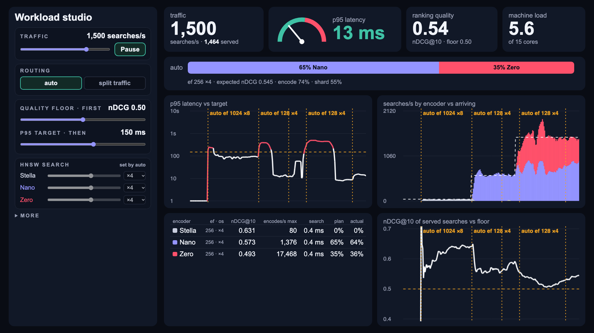

# Workload studio

With a large encoder, encoding the query is most of the cost of a dense search: Stella takes about 28 ms per query on a laptop CPU, the search under 1 ms. Constella keeps one Stella document index and lets each query pick its encoder: Stella (best ranking, about 80 queries/s on a laptop), Nano (a 35M-parameter transformer, about 1,300/s) or Zero (a lookup table, about 17,000/s). The workload studio shows what that buys under real traffic. It replays a BEIR dataset's judged questions against one [Qdrant Edge](https://qdrant.tech/documentation/edge/) shard on your machine, scores every answer, and lets an auto-router choose the encoder mix and the HNSW search width live.



## Run it

You need Python 3.12 and about 3 GB of disk for FiQA (57,638 passages).

```bash
git clone https://github.com/Dylancouzon/asymmetric-dual-encoders.git
cd asymmetric-dual-encoders
python3.12 -m venv .venv
.venv/bin/pip install -r m15/talk/demo/studio/requirements.txt

# Download the Stella document vectors (118 MB) and build the Edge index (under a minute).
.venv/bin/python m15src/talk_edge.py build fiqa

# First start downloads the three query encoders (about 1.9 GB) and measures this machine (about 30 s).
.venv/bin/python m15/talk/demo/studio/app.py
```

Open <http://127.0.0.1:8767> and wait until the subtitle stops saying "starting".

The talk runs on Natural Questions, 2,681,468 passages. Its vectors are a 5.5 GB download, and the Edge build took 3.2 hours on an Apple M5 Pro (19 GB on disk):

```bash
.venv/bin/python m15src/talk_edge.py build nq
DATASET=nq .venv/bin/python m15/talk/demo/studio/app.py
```

The vectors come from the Hugging Face dataset [`Qdrant/constella-demo-vectors`](https://huggingface.co/datasets/Qdrant/constella-demo-vectors). Quality per search setting comes from the committed sweeps `results/m15_talk_edge_fiqa.json` and `results/m15_talk_edge_nq.json`.

## What to try

- **Traffic.** Drag the slider from 40 to a few thousand searches/s. Auto moves from Stella to Nano, then mixes in Zero and narrows the HNSW search. Space pauses; the arrow keys step traffic by 1.5x.
- **Quality floor.** The average nDCG@10 of served searches never drops below it. The default sits just under Zero's best score (NQ: 0.50, FiQA: 0.36).
- **p95 target.** Auto keeps latency under it when the machine can. Quality comes first: past the machine's capacity, every query is still served, the queue grows and the gauge turns red.
- **Split traffic.** Route by hand, with your own ef and oversampling per encoder, and compare with Auto.
- **More.** Daily wave and burst patterns, a spike switch, and agent tasks that fire several searches at once and finish with the slowest.

## How Auto decides

Every 250 ms, `allocator.py` picks the traffic share of each encoder and one search preset (ef 128, 256 or 512 with 4x oversampling, or ef 1024 with 8x). It maximizes the average nDCG@10 of served searches, keeps it at or above the floor, and fits two measured budgets: encode capacity per encoder (measured at startup) and time on the Edge shard, which serves one search at a time in this process. A headroom factor, tuned from measured p95, absorbs what the cost model misses. An encoder too slow for the target on its own is left out unless the floor needs it.

## Code map

| file | role |
|---|---|
| `edge_search.py` | Qdrant Edge search with per-request `hnsw_ef` and `QuantizationSearchParams(rescore, oversampling)`: binary-quantized candidates from RAM, rescored with fp16 vectors on disk, no rebuild |
| `allocator.py` | the routing plan; `python allocator.py` runs its self-check |
| `workload.py` | the seeded traffic replay, worker pool and nDCG@10 scoring |
| `app.py` | startup measurements, live costs, the planning loop, and the HTTP API |
| `index.html` | the page: controls, gauge, plan bar and charts |

Background on the knobs: [search parameters](https://qdrant.tech/documentation/search/search/), [quantization and rescoring](https://qdrant.tech/documentation/manage-data/quantization/), [Qdrant Edge](https://qdrant.tech/documentation/edge/).

## Limits

The questions and judgments are real; the traffic pattern is simulated. Capacity numbers come from one laptop running one Edge shard in one Python process, which tops out near 2,600 searches/s on the M5 Pro whatever the mix. They move on other hardware. These are demo observations, not the project's registered results.
